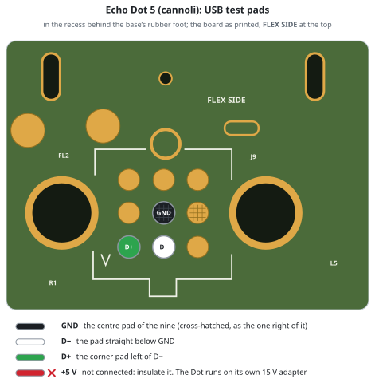

# Echo Dot 5th gen, 2022 (`cannoli`)

Model C2N6L4, MediaTek MT8519BAAV (the AZ2), Fire OS 6.5.7.5 (`NS6575`/8349, 2026-10-27),
`ro.product.device` = `cannoli`. The port is hardware-tested on two units, this one included:
unlocked from stock, set up from a phone, adopted by Home Assistant (2026-11-14/15;
[PLAN.md](../../PLAN.md)).

This is the one model with no guided setup yet: you solder three wires, build the image bundle
yourself and run the installer. The recovery build alone downloads a 26 GB source tree. What makes
it all tick sits at the end of this page: [the boot chain and the
unlock](#reference-the-boot-chain-and-the-unlock).

- **Storage**: NAND (Micron NW942) with UBI volumes `boot_a`/`boot_b`, `uboot_a`/`uboot_b`,
  `system_a`/`system_b`, `tee1`/`tee2`, `scp`, `mcupm`, `brhgptlk_0..3`. No GPT, no eMMC;
  `scripts/otatool.py`'s remount path does not apply.
- **Radio**: MT7653BSN Wi-Fi/BT (eero mesh), two PCB antennas.
- **Audio**: 3 mics through a TI TLV320ADC5140 on the switch PCB, Maxim MAX98396 mono amp (no jack
  this gen), 12 RGB LEDs (W4970 driver), temperature and light sensors.
- **USB**: no connector. It comes out on the 3×3 matrix of gold test pads in a recess behind the
  base's rubber foot — wired up in [the second step](#2-open-the-dot-and-wire-usb) below.

## Read this first

- **The older the Echo's firmware, the likelier the unlock works.** Every unlock uses a hole in
  Amazon's software, and updates close such holes. Which versions still unlock is not tracked here,
  and an unlock that does not take can leave the Echo unusable. Never let the Echo update: do not
  set it up with the Alexa app, and keep it off Wi-Fi until the install is done (an update would
  also move it off build 8349, which everything here is pinned against).
- **Never connect +5 V to the test pads.** The Dot keeps running on its own 15 V adapter; the USB
  wires carry data and ground only.
- **Do not use TWRP's generic wipe, format or ZIP-install menus** on this Dot's NAND — only the
  commands this route uses.
- **Keep the wires soldered, the OS bundle (`work/bundle`) and the install backup
  (`backups/cannoli-original`) safe.** They are the only way back if both system slots are ever
  broken ([why](#reference-the-boot-chain-and-the-unlock)).
- A factory-fresh Dot needs one **one-way step** in the troubleshooting below (an anti-rollback
  fuse, the same one an Amazon update would burn) — [details](#troubleshooting).

## What you need

Besides the [general requirements](../../README.md#requirements) of the project:

- A T8 Torx screwdriver, a fine-tip soldering iron, flux, thin wire (26–30 AWG), and a USB cable to
  sacrifice or a USB breakout board — only its data and ground wires are used
- An x86-64 Linux host with ~35 GB free — the TWRP source tree alone is 26 GB, the builder's
  verified inputs 6 GB — plus `adb`/`fastboot` (platform-tools), `uv`, Python 3.10+,
  `squashfs-tools`, and `qemu-user` (or a static `qemu-arm` to hand the builder)
- Four checkouts as sibling folders — every `../<repo>` path below assumes exactly that:

```sh
git clone https://github.com/Gamer92000/echo-dot-assist
git clone https://github.com/Gamer92000/firebreak
git clone https://github.com/Gamer92000/cannoli-os-builder
git clone https://github.com/Gamer92000/twrp_device_amazon_cannoli
```

Once, from the firebreak checkout: `uv sync`, then

```sh
sudo install -m 644 contrib/73-cannoli.rules /etc/udev/rules.d/
sudo udevadm control --reload-rules && sudo udevadm trigger
sudo usermod -aG plugdev,dialout "$USER"
```

and log out and back in.

## Install

### 1. Prepare the OS-builder inputs

In the cannoli-os-builder checkout (from its README — it downloads the pinned stock firmware
through FTVDB and verifies every hash; the package list is its Debian/Ubuntu one):

```sh
python3 -m cannoli_os.prepare "$PWD/work/inputs"
```

Everything later reuses this folder: the NDK for this port's build, the stock images for the
recovery packaging, the inputs for the OS bundle.

### 2. Open the Dot and wire USB

<picture>
  <source media="(prefers-color-scheme: dark)" srcset="../../docs/img/cannoli-pads-dark.svg">
  
</picture>

Peel the rubber foot off the base with a thin knife or spudger: the pad matrix sits in a recess right behind it.
Undo the four T8 Torx screws underneath for good access to the board. Hold the board as the
diagram draws it — `FLEX SIDE` printed at the top, a round pad just above the matrix, the matrix between the two
large gold screw holes, its centre pad and the one right of it cross-hatched — and solder three wires:

| Pad | Where | USB wire |
|---|---|---|
| GND | centre pad of the nine | black (or shield) |
| D− | straight below GND | white |
| D+ | corner pad left of D− | green |

Leave the cable's +5 V (red) wire unconnected and insulated. Insulate the joints, route the wires
out through the recess, put the screws back in, stick the foot loosely back on, and plug the USB
end into the PC.

### 3. Find the USB serial

Hold the **action button** (the circle) while powering on → fastboot; `fastboot devices` shows the
**USB serial**. Write it down — it names the recovery packaging, the OS bundle and the install.

### 4. Build the recovery

Change to TWRP checkout folder, build the pinned recovery as its README says — the source sync is 26 GB and
the build can take several hours on a typical PC (about 8 minutes on 32 cores). 
First export the path to the stock images with:
`export STOCK_IMAGES=../cannoli-os-builder/work/inputs/images`
Then run `build.sh`. 
Finally, package the recovery for your serial:
```sh
python3 -m cannoli_twrp.pack --images ../cannoli-os-builder/work/inputs/images \
  --ramdisk work/twrp/out/target/product/cannoli/ramdisk-recovery.img \
  --graphics work/twrp/out/target/product/cannoli/system/lib/libminuitwrp.so \
  --serial <serial> --output work/recovery
```

### 5. Build this port's update bundle


Change directory to the echo-dot-assist checkout folder. In this checkout — right before the OS bundle in the next step, so it cannot go stale: a stale
`build/cannoli/hassmic.bundle` bakes a stale port, and the builder cannot tell. `STUBS=1` links
against stand-ins for Amazon's libraries (the binaries come out byte-identical; CI builds this
way, no firmware unpacking needed), and `NDK=` reuses the toolchain step 1 downloaded:

```sh
make kernel-tools DEVICE=cannoli    # optional: the Wi-Fi motion kernel module
NDK=../cannoli-os-builder/work/inputs/android-ndk-r21e DEVICE=cannoli STUBS=1 make all
mkdir -p secrets
[ -f secrets/update.key ] || python3 scripts/otatool.py keygen secrets/update.key secrets/update.pub
DEVICE=cannoli scripts/bundle.sh secrets/update.key "$(DEVICE=cannoli make -s version)"
```

Back `secrets/update.key` up somewhere safe: it signs every future update and opens adb over Wi-Fi.

### 6. Build the OS bundle

Change directory to the cannoli-os-builder checkout folder. In the OS-builder checkout, with the port baked in:

```sh
sudo python3 -m cannoli_os.build \
  --images work/inputs/images --recovery ../twrp_device_amazon_cannoli/work/recovery \
  --adbd work/inputs/adbd --policy work/inputs/magiskpolicy32 \
  --ndk work/inputs/android-ndk-r21e \
  --serial <serial> --port "$(realpath ../echo-dot-assist)" \
  --output work/bundle
```

`--port` is what makes the image boot as a satellite instead of plain rooted stock. Sudo preserves
ownership and SELinux labels inside the image (it will ask for the password). Add
`--qemu /path/to/qemu-arm` when the host's qemu-user is not visible to sudo. Both this step and
the previous one refuse an output folder that already exists: use a new `--output` (or remove the
old one) when you rebuild.

### 7. Unlock and install

Change directory to the firebreak checkout folder. The Dot keeps two system slots: A runs Fire OS, B holds the recovery this install puts there. From
the firebreak checkout:

```sh
uv run firebreak unlock --device cannoli \
  --bundle ../cannoli-os-builder/work/bundle --serial <serial> \
  --backup backups/cannoli-original
```

Follow the power prompts. Each time you power the Dot on, its boot loader answers on USB for only
about 45 seconds — firebreak starts listening before each prompt so it catches that window.
(A first install has nothing to check; later, `--check` reruns the same command as a no-write pass
that only examines the installed recovery.) A failed slot-A write resumes by rerunning with the
**same bundle and backup directory** — never delete the only completed backup to work around an
error.

When the install finishes, firebreak checks the booted system itself: slot A booted, keyless root
adb, SELinux enforcing, no ADB network listener.

## After the install

The Echo boots straight into the port. Set it up from your phone
([Improv](../../docs/GUIDE.md#setting-up-from-a-phone)) and adopt it in Home Assistant, as the
other models do. The guided setup does not cover cannoli yet — `scripts/setup.sh` stops with a
pointer to this README.

[Updates](../../README.md#updating) arrive over Wi-Fi, signed with your key: `git pull`, then
`DEVICE=cannoli scripts/ota-push.sh <echo-ip>` — the DEVICE matters, the default is another model.
On a commit GitHub has built, nothing compiles; on your own unpublished commits it builds locally
and needs the same help as step 5 (`NDK=../cannoli-os-builder/work/inputs/android-ndk-r21e
STUBS=1 DEVICE=cannoli scripts/ota-push.sh <echo-ip>`). Or pick a channel on the settings page.
Volume Up at power-on enters the recovery in slot B.

If you installed rooted stock with firebreak and no `--port`: rebuild the OS bundle with `--port`
and rerun the install.

## Going back to stock

```sh
uv run firebreak restore backups/cannoli-original --device cannoli \
  --bundle ../cannoli-os-builder/work/bundle --serial <serial>
```

This restores slot A from the backup the install took. It does not bring back the original slot-B
images or boot selection — a stock slot-A bootloader also lacks the Volume-Up recovery entry —
which is why the wires and the bundle stay the real safety net.

## Troubleshooting

Both items below affect factory-fresh units (2022 launch firmware) only. Skip them if the install
above ran clean and the ring behaves.

### The install stops at `Unsupported firmware prerequisite:`

Your Dot predates build 8349, and its protected volumes differ from the 8349 set everything here
is pinned against. The installer has already put the recovery in slot B at that point (Volume Up
at power-on), so the fix is to upgrade the stock volumes from that recovery and then rerun the
install. Unpack the pinned 8349 OTA first (in this checkout):

Run each command from the `firebreak` checkout directory.

```sh
mkdir -p ../echo-dot-assist/firmware/cannoli/unpack/parts
unzip -o ../cannoli-os-builder/work/inputs/stock.zip payload.bin -d ../echo-dot-assist/firmware/cannoli/unpack
python3 ../echo-dot-assist/tools/payload_dump.py ../echo-dot-assist/firmware/cannoli/unpack/payload.bin ../echo-dot-assist/firmware/cannoli/unpack/parts
```


Then, flash the dot to the previously extracted 8349 firmware:

```sh
uv run firebreak cannoli-upgrade --device cannoli \
  --bundle ../cannoli-os-builder/work/bundle --serial <serial> \
  --ota-parts /absolute/path/to/echo-dot-assist/firmware/cannoli/unpack/parts
```

It verifies every part against the installer's pins, refuses a Dot already on 8349, and writes
with readback verification ([firebreak's guide][firebreak-guide] has the section).

The first boot of the 8349 TEE raises the anti-rollback eFuse — a one-way step, but the same one
any Amazon update to 8349 would make.

### The light ring stays dark (or swirls forever on rooted stock)

The 2022 launch boot loader (BL2) never starts the 8349 LED co-processor, so nothing ever owns the
ring: dark on the satellite port, an endless boot swirl on rooted stock. The fix flashes the four
`brhgptlk_0..3` partitions with the 8349 image — unlike everything above they are **raw MTD
partitions, not UBI**. First unpack the OTA into parts if not already done in the unsupported firmware step.

Run each command from the `firebreak` checkout directory.

If the command `ls ../echo-dot-assist/firmware/cannoli/unpack/parts/brhgptlk*` returns four entries, then skip this command otherwise you need to unpack the OTA with:
```sh
mkdir -p ../echo-dot-assist/firmware/cannoli/unpack/parts
unzip -o ../cannoli-os-builder/work/inputs/stock.zip payload.bin -d ../echo-dot-assist/firmware/cannoli/unpack
python3 ../echo-dot-assist/tools/payload_dump.py ../echo-dot-assist/firmware/cannoli/unpack/payload.bin ../echo-dot-assist/firmware/cannoli/unpack/parts
```

Then, per partition <partitionNumber> of 0, 1, 2, 3 — back the launch copy up to the PC first, flash, and verify
before moving to the next:

```sh
adb push unpack/parts/brhgptlk_<partitionNumber>.img /tmp/
adb shell dump_image brhgptlk_<partitionNumber> /tmp/before
adb pull /tmp/before lk-launch-backup/brhgptlk_<partitionNumber>-launch.bin
adb shell flash_image brhgptlk_<partitionNumber> /tmp/brhgptlk_0.img
adb shell dump_image brhgptlk_<partitionNumber> /tmp/after
adb shell 'head -c 249856 /tmp/after | sha256sum'   # must equal the next line
sha256sum unpack/parts/brhgptlk_<partitionNumber>.img               # 86e7da8927151fd5…
```

Hash only the image's 249856 bytes: `flash_image` zero-fills the rest of the last erase block of
the 0x40000 partition, so hashing the whole dump never matches. Skip the fix only if a permanently
dark ring is acceptable — the port keeps the ring off on its own either way.

## How the port runs

The port keeps the stock kernel (5.4.86), Amazon's mixer, Pryon wake word engine and DSP firmware
(source identity `cannoli8349-037875a37199e1c67784b51b`). It installs as `INSTALL=cannoli-ubi`: the
offline builder patches the files and the SELinux policy straight into the SquashFS image — the
ext4 installer the other models use refuses this device — and `/system` gets a writable OverlayFS
on `/data`, mounted early in boot by `prepare.sh`. The satellite starts from storage and mixer
readiness instead of Alexa's launch flag, which lockdown clears; rooted stock keeps upstream
automatic updates disabled.

Tested on the two units: cold-boot persistence, enforcing microphone capture, Wi-Fi (with a DHCP
`INFORM6` fix) kept out of power save, phone setup, Home Assistant adoption, push updates, adb
over Wi-Fi, Music Assistant, announcements, the buttons, the light sensor, Wi-Fi motion, the wake
word and echo cancellation in a room, and the ring — the stock ring after the BL2 step above,
Home Assistant's light, settings-page designs and the ring live, frame by frame
([PLAN.md](../../PLAN.md) has the log). Open: Bluetooth audio, the volume curve (the Dot 2's
stands in), guided setup.

Updates never touch the read-only system image, so a broken update cannot brick the Echo. If a
new version works but cuts the Echo off the network, the Echo steps back by itself: after two
boots in a row in which nothing reached it — Home Assistant, the settings page, Music Assistant or
a push update — it goes back one step, to the version before, and each version it steps away from
is never installed again. Home Assistant simply being down counts too: after a power cut that
outlives two boots, the Echo steps back, so expect that after an outage. A broken update means
pulling the plug a few times, not opening the Echo ([the design](../../PLAN.md)). The system image
itself rarely needs reflashing again — only when a release says so in
[CHANGELOG.md](../../CHANGELOG.md); ours carries the 2026-11-15 one.

## Reference: the boot chain and the unlock

| Stage | Where | What |
|---|---|---|
| preloader | `brhgptlk`-adjacent, not in the OTA | exposes a USB serial (0E8D:2000) that accepts a D7 upload / D5 jump of an image to 0x200000 — no exploit needed |
| BL2/LK | `brhgptlk_0..3` | verifies the `uboot` partition FIT (RSA-PSS, `key-fit`, the key sits in an FDT inside BL2 at 0x353E8) |
| U-Boot | `uboot_a`/`uboot_b` | **2019.04-g71f44a240c** (built 2026-04-07), a FIT itself; AArch64, loads 0x44E00000; `mtk_boot` = `ubi read … ${boot_partition}; bootm …#conf-1`; Volume-Up hook is patched in by the builder |
| kernel | `boot_a`/`boot_b` | signed FIT, `sha256,rsa2048`, key `fireos-production`, one config per board rev (`cannoli-hvt`, `cannoli-evt-aluminum`, …, plus `cannoli-*-recovery` with a ramdisk) |

CVE-2026-46728 lives here: U-Boot's `fit_config_check_sig()` reads the `hashed-nodes` hint from
the FIT being verified (attacker-controlled, itself unsigned) — confirmed in the disassembly at
0x44E2FB90 (`fdt_getprop(fit, noffset, "hashed-nodes", …)`), strings `Can't get hashed-nodes
property` / `hashed-nodes property must be null-terminated`. The BL2→uboot check falls to the same
flaw. `cannoli-os-builder`'s `shadow()` weaponizes it: the stock `kernel-1` node moves into an
`archive/` subnode, the signature's `hashed-nodes` is repointed at the archive copy, and the
patched payload replaces the real node — the signed byte stream is unchanged, so **Amazon's stock
signature verifies over a fully patched U-Boot** (proved offline against the real key).

This is also the recovery story: the preloader's USB route needs no working system at all, so even
a Dot with both slots broken answers on the pads again — keep the wires on. The route is tested
end-to-end (rooted slot A, recovery slot B, Volume-Up entry) and lives in the three repositories
beside this one: [firebreak] installs, and its [cannoli guide][firebreak-guide] tells this same
story at full length; [cannoli-os-builder] builds the bundle; [twrp_device_amazon_cannoli] builds
the recovery. The pinned OTA is the one [FTVDB's 8349 record][firmware] names
(sha256 `a55e7223…f5996d9`); if you keep a copy, it and its unpacked parts sit under
`firmware/cannoli/` (git-ignored, never in the repository).

[firebreak]: https://github.com/Gamer92000/firebreak
[firebreak-guide]: https://github.com/Gamer92000/firebreak/blob/main/docs/cannoli.md
[firmware]: https://ftvdb.com/echo/firmware/com.amazon.cannoli.android.os/0bf96b3cd8fca30fdd12f61208e44d76-13323246980-fire-os-6-5-7-5-ns6575-8349-2026-10-27/
[cannoli-os-builder]: https://github.com/Gamer92000/cannoli-os-builder
[twrp_device_amazon_cannoli]: https://github.com/Gamer92000/twrp_device_amazon_cannoli
