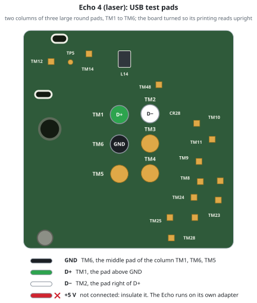

# Echo 4th gen, 2020 (`laser`)

Model L4S3RE, MediaTek MT8512, Fire OS 6.5.7.5 (`NS6575`/8349, 2026-10-27),
`ro.product.device` = `laser`, `ro.product.model` = `AEOLS`. Firmware: [the FTVDB
record][firmware], `update-kindle-laser_mt8512-NS6575_user_8349_0013323246980.bin`,
126850620 bytes, SHA-256 `a117deba…f88218f`.

**Status (2026-11-27): installed on one unit and working as a voice satellite.** That
Echo was rooted and installed with Firebreak's laser route, from a firmware bundle with
this port baked in (laser-os-builder `--port`); the same build had run on it before from
a trial deploy. On its first boot the overlay came up, Alexa was switched off, the
egress lockdown applied, the ring's animations installed, and hassmic started,
advertising for setup from a phone. Then, on that unit: setup from a phone (Improv
over Bluetooth), adoption by Home Assistant, requests through the voice pipeline, every
button, and the settings page's "Download from Amazon" (login and every model). Push
updates work (`scripts/ota-push.sh` to the unit, taken, run, self test passed, promoted),
the live light ring is tested on the unit, and the volume curve is measured on it
(`board_vol_laser`). Still to do: phone calls (built from the firmware, not tried) and the
rollback. Like the Echo Dot 5, it works by hand and has no guided setup yet.

- **Storage**: eMMC with A/B slots: `boot_a`/`boot_b`, `uboot_a`/`uboot_b` (the slot's
  loader, loaded by the LK), `system_a`/`system_b` (ext4 system-as-root, 0x3e800000
  each), `misc` with the boot-control block, `tee1`/`tee2`, `lk`, and a `recovery`
  partition that stock leaves empty. The slot is chosen by the block in `misc`.
- **Software**: as cannoli's, the same Fire OS build. `libmixerAPI.so` and `libpryon.so`
  are byte-identical to cannoli's; the Alexa client is `puffin` (`/system/bin/PuffinApp`),
  the Bluetooth device `/dev/stpbt` with `btmanagerd`, the Wi-Fi driver
  `wlan_mt76x3_sdio`.
- **Audio**: ALSA card 0 (`mtsndcard`: `DLM`, `DL2`, `DL3`, `DL6` playback, `UL1`…`UL5`,
  `UL8`…`UL10` capture) and card 1 (`sndvoicedspcard`, the voice DSP). The amplifier is
  a TI TAS5805M with a digital volume per channel.
- **Sensors**: a TSL2572 light sensor (IIO, `calibrated_lux`), SoC temperature as
  `mtktscpu`.
- **LEDs**: 24, on two TI LP5036 (i2c 0-0030 and 0-0031, one `lp5036:ledmod_N` LED
  class device each); ledcontroller with text animations of 24 pixels
  (`/system/etc/led-resources`, 30 volume steps), as the Dots' 12. The light ring live
  writes each LED's colour file and the chips' supply switch, as the LED HAL does
  (tested on the unit, 2026-11-28: a colour from Home Assistant, the Echo's own pattern
  over it and back).
- **Wi-Fi motion**: cannoli's Wi-Fi driver, laser's own kernel with module versions;
  works on the first unit (2026-11-27).
- **Thread and Zigbee**: a Qorvo GP712 on `/dev/gp`, which stock drives through Amazon's OpenThread RCP
  (`/system/bin/ot-rcp`). Stock's Thread border router, Thread service and Zigbee hub are stopped; the settings
  page's Thread & Zigbee page runs our own border router or router there, our own Zigbee coordinator (for ZHA or
  Zigbee2MQTT) or router ([docs/zigbee.md](../../docs/zigbee.md)), or hands the radio to Zigbee2MQTT
  ([docs/re-thread.md](../../docs/re-thread.md), the guide's
  [Thread and Zigbee](../../docs/GUIDE.md#thread-and-zigbee-echo-4)). The radio program under them is ours by
  default (gprcp: OpenThread's RCP on Qorvo's library, transmit security and timing in software), Amazon's ot-rcp on
  request. On the first unit (2026-11-27): a border router of its own, leader with border routing, SRP and the
  border agent, Home Assistant's own client library (python-otbr-api 3.1.0) against it, and Zigbee2MQTT's zoh stack
  forming a network over the radio from a PC; NAT64, TREL and the backbone router; zigbeed as coordinator
  (zigpy-deconz over Wi-Fi formed a network) and as a router that joined a real ZHA network (an EmberZNet
  coordinator; its own link key confirmed); on gprcp, Home Assistant's OTBR integration on a real Home Assistant
  (added with the URL: it formed its network, the Echo leader within 6 s). And CSL with a sleepy nRF52840
  (2026-11-28, on a second Echo 4, behind the experimental setting). Not tried: a Thread or Matter device, a Zigbee
  device of a manufacturer on zigbeed, Home Assistant's OTBR add-on with the Echo as its radio.
- **Inputs**: `gpio-keys` (volume down, volume up, the action button) and the
  `gpio-privacy` driver for the mute latch and its button.
- **USB**: no connector. It comes out on three of the six large round test pads
  printed `TM1` to `TM6` (GND on `TM6`, D+ on `TM1`, D− on `TM2`): wired up in
  [the second step](#2-wire-usb) below, the same wires Firebreak's route needs.

## Read this first

- **Build 8349 (NS6575) is the only one this was developed and tested on.** The install
  writes only slot B (the rooted 8349 system, stock boot image and loader) and selects it;
  it never touches slot A, the TEE (`tee1`, `tee2`) or the LK, and it does not require the
  Echo to be on 8349. Whether an older TEE runs the 8349 system is not analysed, here or
  in [Firebreak's laser guide](https://github.com/Gamer92000/firebreak/blob/main/docs/laser.md).
  The ways it could fail that are known are recoverable: an older bootloader could refuse
  the 8349 loader in the preloader window (nothing is written, and you are back where you
  started), or slot B could fail to boot (slot A is untouched, and `firebreak unlock
  --device laser --select-a` returns to stock). Slot A, your stock fallback, stays as it
  was either way. If you try it on a unit on an older build, please report how it went.
- **Never let the Echo update.** An update moves it off 8349, which the rest of this page is
  pinned to: do not set it up with the Alexa app, and keep it off Wi-Fi until the install is
  done.
- **Read Firebreak's laser guide before the first flash**, and take its warning
  seriously: it opens with how a wrong loader image bricks this Echo.
  [firebreak/docs/laser.md](https://github.com/Gamer92000/firebreak/blob/main/docs/laser.md).
- **Keep the wires on.** The preloader's USB window is the way in when nothing else
  boots; `firebreak unlock --device laser --select-a` is the way back to stock slot A.
- **Only data and ground go on the USB pads.** The Echo runs on its own adapter.

## What you need

Besides the [general requirements](../../README.md#requirements) of the project:

- A T10 Torx screwdriver, a fine-tip soldering iron, flux, thin wire (26–30 AWG), and a
  USB cable to sacrifice or a USB breakout board: only its data and ground wires are used
- An x86-64 Linux host with `adb`/`fastboot` (platform-tools), `uv`, Python 3.10+,
  `e2fsprogs` and `qemu-user` (the OS builder loops the system image and runs the
  policy tool under qemu); about 4 GB of free disk for laser-os-builder's inputs and
  image (no recovery is built, unlike the Echo Dot 5's 26 GB tree)
- Three checkouts as sibling folders: every `../<repo>` path below assumes exactly that.
  Each command block below starts with the `cd` into the checkout it runs in; the paths
  in it count from there.

```sh
git clone https://github.com/Gamer92000/echo-dot-assist
git clone https://github.com/Gamer92000/firebreak
git clone https://github.com/Gamer92000/laser-os-builder
```

Once, in the firebreak checkout (always run it from there as `uv run firebreak`):

```sh
cd firebreak
uv sync
sudo install -m 644 contrib/73-laser.rules /etc/udev/rules.d/
sudo udevadm control --reload-rules && sudo udevadm trigger
sudo usermod -aG plugdev "$USER"
```

and log out and back in.

## Install

### 1. Prepare the OS-builder inputs

In the laser-os-builder checkout, with the firmware file from the record above
([its README](https://github.com/Gamer92000/laser-os-builder) has the details; the
preparer verifies the pinned checksum before it extracts anything):

```sh
cd ../laser-os-builder
python3 -m laser_os.prepare "$PWD/work/inputs" \
  --ota /absolute/path/to/update-kindle-laser_mt8512-NS6575_user_8349_0013323246980.bin
```

### 2. Wire USB

<picture>
  <source media="(prefers-color-scheme: dark)" srcset="../../docs/img/laser-pads-dark.svg">
  
</picture>

Disconnect the Echo's power first. Peel the rubber foot off the base (it comes off by
hand; a spudger helps start it) and undo the four T10 Torx screws under it, then lift
the base off to reach the board. On the board, find the six large round gold pads in
two rows of three, each printed with its name: `TM5`, `TM6`, `TM1` in one row and `TM4`,
`TM3`, `TM2` in the other (the diagram turns the board so the printing reads upright:
the rows are its columns). Small square pads `TM8`…`TM11`, `TM24`, `TM25` sit beside
them, a large hole and two oval slots on the other side. Solder three wires:

| Pad | Where | USB wire |
|---|---|---|
| GND | `TM6`, the middle pad of the row `TM5`, `TM6`, `TM1` | black (or shield) |
| D+ | `TM1`, at the end of that row | green |
| D− | `TM2`, next to `TM1` in the other row | white |

Leave the cable's +5 V (red) wire unconnected and insulated: the Echo runs on its own
adapter. Insulate the joints, route the wires out, and plug the USB end into the PC.
Leave them on after the install: the preloader's window is the way back when nothing
else boots. `TM10` and `TM11` are the LED chips' I2C, not a console: this board has no
UART.

### 3. Find the USB serial

Power the Echo on while holding the **action button**: it starts its fastboot, and
`fastboot devices` shows the **USB serial**. Keep it in a variable for the steps below,
in the same terminal (or set it again in a new one):

```sh
fastboot devices
export LASER_SERIAL=REPLACE_WITH_USB_SERIAL
```

Unplug the power again afterwards: the install asks for it.

### 4. Build this port's update bundle

In this checkout (echo-dot-assist), right before the OS bundle in the next step, so it
cannot go stale: a stale `build/laser/hassmic.bundle` bakes a stale port, and the
builder cannot tell.

```sh
cd ../echo-dot-assist
DEVICE=laser scripts/port-bundle.sh
```

It takes this commit's release build from GitHub where there is no Android NDK in
`toolchain/` (`PREBUILT=1` always, `PREBUILT=0` never; a commit GitHub has not built
needs the NDK, and for this model also cmake, ninja, zig and `make kernel-tools
DEVICE=laser`; `STUBS=1` links against stand-ins for Amazon's libraries, so no firmware
needs unpacking: [DEVELOPMENT.md](../../DEVELOPMENT.md)). It signs the bundle with
`secrets/update.key` and makes that key pair (`update.pub` beside it, which the OS
builder bakes in) when there is none. Back `secrets/update.key` up somewhere safe: it
signs every future update and opens adb over Wi-Fi.

### 5. Build the OS bundle

In the laser-os-builder checkout. `--port` bakes this port into the system image, with
its SELinux rules, so the Echo boots hassmic instead of Alexa. The build's system step
needs sudo (a loop mount).

```sh
cd ../laser-os-builder
sudo python3 -m laser_os.build \
  --images "$PWD/work/inputs/images" \
  --adbd "$PWD/work/inputs/adbd" \
  --policy "$PWD/work/inputs/magiskpolicy32" \
  --serial "$LASER_SERIAL" \
  --port "$(realpath ../echo-dot-assist)" \
  --output "$PWD/work/bundle"
```

The build refuses an output folder that already exists: use a new `--output` (or remove
the old one) when you rebuild.

### 6. Unlock and install

From the firebreak checkout. Read-only first: it loads the loader into RAM through the
preloader's window, checks what answered, and practises the rescue move with nothing
written.

```sh
cd ../firebreak
uv run firebreak unlock --device laser \
  --bundle ../laser-os-builder/work/bundle \
  --serial "$LASER_SERIAL" \
  --check
```

Then the install itself, following the power prompts:

```sh
uv run firebreak unlock --device laser \
  --bundle ../laser-os-builder/work/bundle \
  --serial "$LASER_SERIAL"
```

It writes the rooted system, the stock boot image and the verity-gated loader to slot
B and selects the slot last; slot A stays stock. You power-cycle the Echo when it asks,
and it checks the booted system itself before it says it is done: slot B booted, keyless
root adb, SELinux enforcing, and no adb network listener (USB only). If slot B does not
come up, `firebreak unlock --device laser --select-a` (the [Going back to
stock](#going-back-to-stock) command) selects slot A again.

Done on one unit on 2026-11-26, end to end: the check (the window, the loader's
identity, the rescue rehearsal) and the install. The first boot takes four and a half
minutes before hassmic starts: it installs the ring's animation set (4221 files)
through the overlay, and the stock boot swirl runs until that is done and Alexa is
switched off. The ring then shows the setup spinner. Later boots skip the install.

## After the install

As on the other models: set the Echo up from a phone
([Improv](../../docs/GUIDE.md#setting-up-from-a-phone)) and adopt it in Home
Assistant. After the install the Echo advertises for it ("improv: not set up and no
network: advertising, open to any phone" in `/data/local/hassmic/boot.log`); setup
from a phone worked on the first unit (2026-11-27). Its settings page is on port 28931.
The guided setup does not cover this model: `scripts/setup.sh laser` stops with a
pointer to this README.

[Updates](../../README.md#updating) arrive over Wi-Fi, signed with the same
`secrets/update.key` the install bundle was signed with: `git pull`, then
`DEVICE=laser scripts/ota-push.sh <echo-ip>` — the `DEVICE` matters, the default is
another model. On a commit GitHub has built, nothing compiles; on your own unpublished
commits it builds here and needs the toolchain [step 4](#4-build-this-ports-update-bundle)
names. Or pick an update channel on the settings page, which fetches the same signed
bundles from GitHub. An update only replaces the port on slot B; it never touches slot
A, the loader or the TEE, so it cannot move the Echo off build 8349.

## Going back to stock

Slot A is never written. This selects it again, through the preloader's window:

```sh
cd ../firebreak
uv run firebreak unlock --device laser \
  --bundle ../laser-os-builder/work/bundle \
  --serial "$LASER_SERIAL" \
  --select-a
```

## How the port runs

It installs as `INSTALL=laser-emmc`: laser-os-builder writes the port's files into
`/system/hassmic` and patches the SELinux policy in the ext4 image before it is
flashed; `install-system.sh` refuses this model. As on cannoli, the root is as flashed
and `/system` gets a writable overlay on `/data` (`devices/laser/prepare.sh`, run at
`post-fs-data` by `/init.hassmic.rc`), where every promotion puts the factory copy; the
rollback after two boots without being reached is cannoli's too.

[firmware]: https://ftvdb.com/echo/firmware/com.amazon.laser.android.os/de6d85aee9055e1f5192ee186d11648c-13323246980-fire-os-6-5-7-5-ns6575-8349-2026-10-27/
