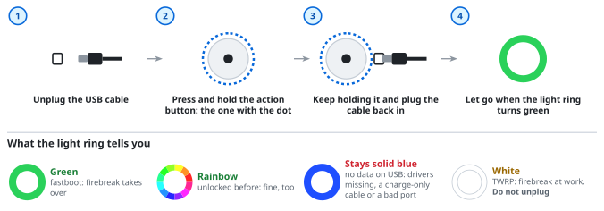

# Echo Dot 2 from Windows, step by step

This page is for you if you have never used a command line, git or adb, and want to turn an **Echo Dot 2nd gen**
into a Home Assistant voice satellite from a **Windows** PC. Every command on this page is copied and pasted in
full; nothing has to be worked out. It takes about an hour and a half: half an hour to install the tools, the rest
mostly waiting.

> [!NOTE]
> Each part of this has run on Windows: firebreak (the unlock) on Windows 11 by its author, the setup's steps
> after the unlock from Git Bash (issue #49). Nobody has reported the whole way from a new Echo yet. If you
> do it, please say how it went in [issue #67](https://github.com/Gamer92000/echo-dot-assist/issues/67), whether it
> worked or not: that is how this page gets better.

## 1. Check your Echo

Turn the Echo over: its **model number** is printed on the underside. This page is for **RS03QR**, the Echo Dot
2nd gen (2016). Several Echos look alike, so go by that number, not by the looks, and find it in the
[Supported Echos](../README.md#supported-echos) table. Another model: follow its own page from that table instead,
which says what it needs and whether Windows can do it.

You also need:

- A **Windows 10 or 11 PC** with an Intel or AMD processor. Windows on ARM (some Surface and Snapdragon laptops)
  does not work: the USB drivers the unlock needs exist for Intel and AMD only.
- A **micro-USB cable that carries data**. Many cheap cables only charge. One that has ever moved photos off a
  phone is a data cable.
- **Home Assistant** with a working voice assistant (Assist): try talking to it in the Home Assistant app first.
- **Wi-Fi** with a WPA2 password (the usual kind at home), on the same network as Home Assistant.

> [!IMPORTANT]
> **Do not set the Echo up with the Alexa app, and do not let it onto Wi-Fi before the unlock.** Amazon updates it
> as soon as it is online, and a newer version may not unlock any more. An Echo that was in use with Alexa before
> often still works; the setup tells you if not. Leave it unplugged until step 4.

## What the words mean

| Word | What it is |
|---|---|
| **PowerShell** | Windows' own command window. You use it only to install tools. |
| **Git Bash** | A second command window, installed with Git. The setup runs in it. |
| **adb**, **fastboot** | Google's programs that talk to Android devices over USB. The Echo runs a kind of Android. |
| **Unlock** | Lets the Echo run software that is not Amazon's. Done once. |
| **firebreak** | The program that does the unlock on Windows ([github.com/bboe/firebreak](https://github.com/bboe/firebreak)). The setup runs it for you. |
| **TWRP** | A small repair system the unlock puts on the Echo. Its ring is white. |
| **The setup** | `scripts/setup.sh` from this project. It does everything in order and stops whenever it needs you. |

## Is it safe?

The setup **wipes the Echo**: Alexa is gone afterwards (firebreak can bring it back, see the end of this page).
Only one part can **brick** it, that is, leave it dead: pulling the cable or switching the PC off while firebreak
writes to the Echo in step 5. Everything before and after that you can stop at any time with **Ctrl+C**, and the
next run carries on where it stopped. Before step 5:

- Plug a laptop into its charger.
- Stop the PC from going to sleep: Windows Settings, System, Power, set "sleep" to **Never** for the next hour.

## 2. Install the tools (once per PC)

<picture>
  <source media="(prefers-color-scheme: dark)" srcset="img/windows-tools-dark.svg">
  
</picture>

**Opening PowerShell:** press the Windows key, type `PowerShell`, press Enter. **As administrator:** type
`PowerShell`, then right-click "Windows PowerShell" and choose "Run as administrator"; Windows asks "Do you want to
allow this app to make changes", answer Yes. To paste a command into PowerShell, right-click in the window, then
press Enter.

1. **Git for Windows.** In PowerShell:
   ```powershell
   winget install Git.Git
   ```
   If it asks you to agree to terms, type `Y` and Enter. The same goes for the other `winget` lines below.
2. **Python.** Go to [python.org/downloads](https://www.python.org/downloads/), click the yellow "Download Python"
   button and run the file. On its first screen, **tick "Add python.exe to PATH"** at the bottom, then click
   "Install Now".
3. **adb and fastboot.** In PowerShell:
   ```powershell
   winget install Google.PlatformTools
   ```
4. **uv**, which runs firebreak. In PowerShell:
   ```powershell
   winget install astral-sh.uv
   ```
5. **The two USB drivers**, in a PowerShell **as administrator**. Paste all of these at once (from
   [firebreak's README](https://github.com/bboe/firebreak#windows)):
   ```powershell
   cd $env:TEMP
   curl.exe -fo fastboot.cab https://catalog.s.download.windowsupdate.com/d/msdownload/update/driver/drvs/2016/10/20940218_0ae8695c01fb84d1fdea5c9a04baf336ec5b1ba7.cab
   curl.exe -fo mtk.cab https://catalog.s.download.windowsupdate.com/d/msdownload/update/driver/drvs/2016/07/20896845_fdc6bb5aa9a9bac99adf85d931d6c21d1130a96e.cab
   mkdir -Force fastboot, mtk
   expand -F:* fastboot.cab fastboot
   expand -F:* mtk.cab mtk
   pnputil /add-driver fastboot\tplink_winusb.inf /install
   pnputil /add-driver mtk\cdc-acm.inf /install
   Remove-Item -Recurse fastboot.cab, mtk.cab, fastboot, mtk
   ```
   They come from Microsoft's own driver catalogue. Both `pnputil` lines should end with "Driver package added
   successfully".

Then **close every PowerShell window**. From here on everything happens in Git Bash.

## 3. Get this project

Press the Windows key, type `Git Bash`, press Enter. A black window opens. **Pasting in Git Bash** is different:
**Shift+Insert**, or right-click and "Paste" (Ctrl+V does not work there). Paste these three lines and press Enter:

```sh
git clone https://github.com/Gamer92000/echo-dot-assist.git
cd echo-dot-assist
git checkout "$(git tag -l 'v*' --sort=-creatordate | head -1)"
```

The first line copies the project into a folder `echo-dot-assist` in your user folder
(`C:\Users\<you>\echo-dot-assist`). The third picks the newest version GitHub has built and published, so nothing
has to be compiled on your PC. It prints a message about "detached HEAD": that is normal.

Want to see first what the setup will do, without touching the Echo? `scripts/setup.sh biscuit --dry-run` walks
through every step and only shows the commands.

## 4. Run the setup

In the same Git Bash window:

```sh
scripts/setup.sh biscuit
```

(`biscuit` is Amazon's internal name for the Echo Dot 2.) It shows a warning; type `yes` and Enter to start.

<picture>
  <source media="(prefers-color-scheme: dark)" srcset="img/windows-run-dark.svg">
  
</picture>

The setup goes through ten steps and says each time what it does. Where it needs you:

- **Step 1, tools.** It says `all tools there`. If it says `missing:` instead, install what it names (section 2),
  close Git Bash, open it again and type:
  ```sh
  cd echo-dot-assist
  scripts/setup.sh biscuit
  ```
  That is how you **continue after any stop**: the setup remembers what is done. The same step also checks that
  GitHub has a published build of your copy (see "Something went wrong" if it says no).
- **Step 2, one download.** It shows a link to the XDA forum thread and waits. Open the link and find the
  attachment **`boot-root.zip`** in the thread's first post. XDA may ask you to sign in (a free account). Save it
  to your normal **Downloads** folder; the setup notices it by itself and goes on. Do not rename the file.
- **Step 4, the cable.** Plug the micro-USB cable into the Echo (its socket is on the back) and into a USB port **on
  the PC itself**, not a hub or a monitor. The Echo's own power adapter stays **unplugged**: the PC powers it.
- **Step 5, the unlock.** It asks `Are the drivers installed?`: press Enter (yes). Then firebreak starts; the first
  time it downloads what it needs. When it asks, do this:

<picture>
  <source media="(prefers-color-scheme: dark)" srcset="img/dot2-unlock-dark.svg">
  
</picture>

- **Then firebreak works** for about ten minutes. The ring goes white while it writes. **Do not unplug the Echo and do
  not touch the PC until the setup moves on to step 6.** If firebreak stops with an error, nothing is lost:
  press Enter to try again, and it carries on where it stopped.
- **Steps 6 to 8** run by themselves.
- **Step 9, Wi-Fi.** It lists the networks the Echo hears. Type your Wi-Fi's name exactly as listed (capitals
  count), then its password. **The password does not show while you type**; that is on purpose. Press Enter.
- **Step 10, install.** It asks `Settings to start with`: press Enter. (This is for your second Echo: settings
  exported from the first.) The Echo restarts; the setup waits until the satellite runs.

At the end it says `"Echo Dot 2 …" is running at <address>` and what to do next. Now you can unplug the USB cable
and give the Echo its own power adapter.

## 5. Add it to Home Assistant

1. In Home Assistant: **Settings → Devices & services**. A discovered "ESPHome" device appears, named
   "Echo Dot 2" plus six letters and digits. Click **Add**. (Not there after a few minutes? "Add integration",
   ESPHome, enter the address the setup showed, port `26053`, no encryption key.)
2. On its device page pick an **Assist pipeline**, and give it a name of your choice.
3. Say **"Alexa"**.

Everything else is on the Echo's own **settings page**: `http://<its address>:28931/`, or "Visit" on its device
page in Home Assistant. A press of the Echo's action button lets your browser in. What is there:
[the guide](GUIDE.md#settings-page).

## 6. Keep one file safe

In `C:\Users\<you>\echo-dot-assist\secrets\` is **`update.key`**. Copy it somewhere safe (a USB stick, your cloud
storage). It is the key your Echo trusts for updates you send it yourself. Updates from this project's releases do
not need it: switch on "Online updates" on the settings page.

## Something went wrong

The setup writes everything it did to `C:\Users\<you>\echo-dot-assist\build\biscuit\setup.log`. Attach that file
when you ask for help.

| What you see | What to do |
|---|---|
| `missing: python3` although you installed Python | Python's installer ran without "Add python.exe to PATH". Run it again: "Modify", "Next", tick "Add Python to environment variables", "Install". Open Git Bash anew. |
| `missing: adb fastboot` or `uvx` | Close Git Bash and open it anew (it only sees tools installed before it started). Still missing: run the `winget` line again. |
| `no release build of this commit on GitHub` | Your copy is not exactly a published version. In Git Bash, in `echo-dot-assist`: `git fetch --tags`, then the `git checkout` line from section 3 again. |
| `bash: scripts/setup.sh: No such file or directory` | You are not in the project folder: `cd ~/echo-dot-assist` first. |
| At the gesture the ring **stays solid blue** | No data reaches the PC: the drivers (section 2, item 5), a charge-only cable, or a bad port. Try another cable, then another USB port on the PC itself. |
| The ring **restarts** again and again, little or no white | That USB port cannot power the Echo. Use a port on the PC itself with nothing else plugged in next to it. |
| firebreak stops with an error | Press Enter to run the step again; firebreak continues where it stopped. Still failing: run `uvx --managed-python firebreak@0.8.0 report` in Git Bash and post what it prints, with `setup.log`, in an issue here or in `#support-device-unlocking` on the [EchoMuse Discord](https://discord.gg/vAPHMDvREG). |
| The setup stopped, or you closed the window | Open Git Bash, `cd echo-dot-assist`, `scripts/setup.sh biscuit`. It carries on. |
| Home Assistant does not find the Echo | Add it by hand (section 5, step 1). The Echo and Home Assistant have to be on the same network. |

**Alexa back?** With the Echo on USB, `uvx --managed-python firebreak@0.8.0 stock` in Git Bash puts Amazon's
software back and erases the Echo, as it came from the shop.

Everything this page leaves out, and the same steps for Linux: [devices/biscuit/README.md](../devices/biscuit/README.md)
and the [README](../README.md).
